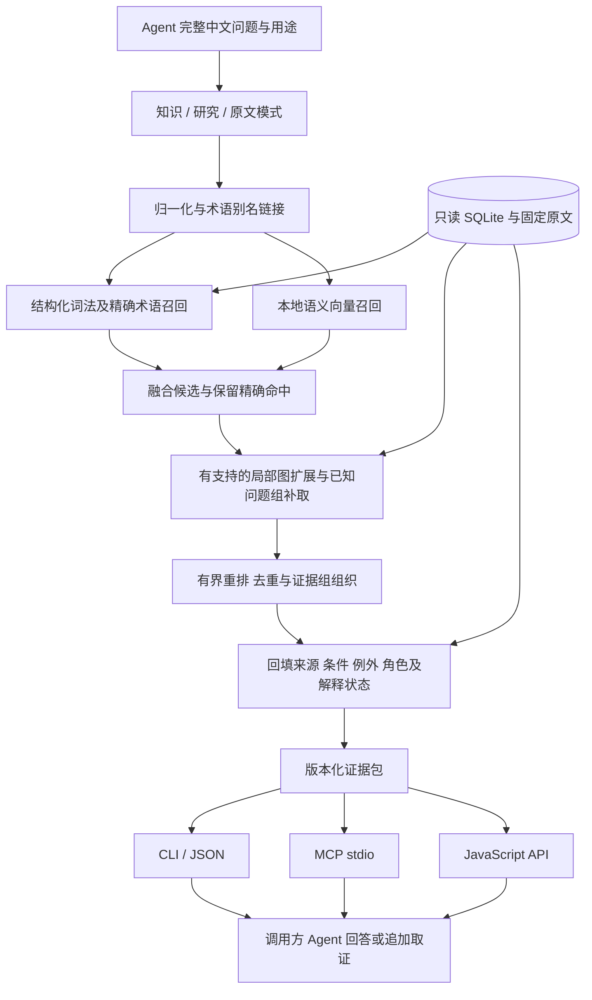

# 面向 Agent 的缠论 RAG＋知识图谱增强检索：完整实施计划

版本：计划 1.0｜日期：2026-10-22｜工作目录：`C:\Users\13240\Desktop\RAG`

**目标：交付一个可直接使用的 Windows 本地 Agent 检索项目，提供可追溯、保留条件和歧义的知识图谱增强检索。最终产物为独立目录及 ZIP，内含运行时、模型、知识库、索引和接入说明。**

本文件是后续实施的统一入口，整合已经确认的交付范围、业界与学术研究、当前项目盘点、歧义处理、目录清理和验收要求。基础方案已获用户确认；模型、参数和性能目标按本文规定的实验程序确定，不再重复询问已确认的产品选择。

当前范围（2026-10-24）：用户已明确要求“别下了，直接交付x64，清除虚拟机容器等等本次安装下载的环境，全部清除”，并要求继续完成交付、清理。此决定取代此前 ARM64 和容器验收要求。最终交付为 Windows 10/11 x64 便携包，沿用已冻结的检索、模型和知识；ARM64、容器验证均记为用户取消，不记通过。当前证据见 `validation-runs/x64-delivery-20261023`，最终产物和清理结果以《交付与验收报告》及交付回执为准。

实施结果（2026-10-24）：M0—M7 已按最终 x64 范围完成；实际最终 ZIP 已通过独立 Windows 断网普通用户验收。本轮虚拟机、临时软件、镜像、下载和冗余派生产物已清理；Windows 系统维护仍提示一次待重启。正式入口见 [交付与验收报告](交付与验收报告.md)。

## 1. 已确认的交付决定

| 项目 | 执行决定 |
| --- | --- |
| 使用者 | 调用检索工具的 Agent；面向人的桌面应用退出本项目交付主线 |
| 检索主线 | 中文词法、术语与别名＋本地向量召回 → 候选融合 → 有证据支持的局部图扩展 → 有界重排和上下文组织 → 证据包 |
| 方法参照 | 以 KG²RAG 的语义种子、图扩展、上下文组织为主要参照，按现有审校图谱适配 |
| 事实源 | 继续使用现有 SQLite 与固定两册 PDF，保留稳定 ID、来源、条件、例外、身份和复核记录 |
| 接入 | 一个检索核心，同时提供 CLI/JSON、JavaScript API、本地 MCP stdio |
| 回答生成 | 调用方 Agent 生成最终答案；本项目提供检索、取证、追加查询和引用材料 |
| 运行 | Windows 10 1809+／Windows 11 x64、CPU 可用、本地离线检索，日常使用无需另装 Node、Python 或开发工具；最终以用户后续明确的仅交付 x64 决定为准 |
| 模型费用 | 检索不依赖额外付费生成式 API；本地 embedding、重排模型随包提供并记录来源与许可 |
| 知识范围 | 默认使用 reviewed 知识；保留 473 条显式歧义；研究模式显式开放 pending 线索；原文模式保留真实来源身份 |
| 歧义原则 | 保存有效信息、语境和替代解释，明确未知条件；解释假说与作者明说分别记录 |
| 目录整理 | 活动目录聚焦 Agent、共享知识源、必要维护材料和正式交付；桌面端及其依赖退出活动目录 |
| 后续实验 | PPR、社区摘要、Global/DRIFT、内部 LLM 路由另行验证，不进入首版必交范围 |

“可以直接使用”的完成条件是：用户解压最终 ZIP、按说明启动 CLI 或配置 MCP，即可在移动后的目录中离线查询，得到带版本、出处、条件、复核状态和歧义说明的证据；不需要从源码构建，也不依赖旧桌面端。

首版同时说明语义研究覆盖与未决问题。可用产品交付不以“把全部歧义解释成唯一结论”或“把全部候选升格为 reviewed”为前提。

## 2. 当前基线与已有资产

### 2.1 固定知识版本

依据当前 [manifest](shared-knowledge/v0.1.0/manifest.json) 和专项只读盘点：

| 资产或状态 | 当前值 | 使用边界 |
| --- | ---: | --- |
| graph_version / schema_version | `0.1.0-review-307029129712` / `1.1.0` | 当前基线；正式变更按新版本发布 |
| 构建阶段 | `semantic_review_in_progress` | 提取覆盖与语义复核完成度分别报告 |
| PDF / 实际页数 / 来源单元 | 2 / 907 / 110 | 固定汇编底本，未声明与原博客逐字一致 |
| 原文段落 / 图形记录 / 概念 | 9650 / 528 / 318 | 存在记录不等于每项语义或图像解释均已核定 |
| 全部命题 | 6008 | reviewed 3369＋pending 2611＋rejected 28 |
| reviewed 命题关联引文 | 4584 | evidence 本身没有独立 review_status，按所属命题和精确引文范围解释 |
| 关系 / reviews 记录 | 692 / 3459 | reviews 条数与命题条数不是同一指标 |
| reviewed 中显式歧义 | 473 | 已在默认知识集合内；其余 2896 条标记为 none |

reviewed 表示当前工程已有出处、身份、转述和条件的复核记录；不能因此宣称经验效果、数学证明、作者意图统一或独立人工复核已成立。模型多视角复核如实标明执行者，不能称为人工金标准。

基线 SHA-256，实施前重新核对并纳入运行记录：

| 文件 | SHA-256 |
| --- | --- |
| `shared-knowledge/v0.1.0/graph.sqlite` | `3463d772e607c6e89104c17c02c6b3656cca766f444d226c011fb9d8a9017271` |
| `shared-knowledge/v0.1.0/manifest.json` | `4eafc2500d74089d2b8a113598afb83470c4553d53748a5ca6207f614c238aac` |
| `volume_1.pdf` | `a53e99c37ca500917ee5edf1d21efcb58f1b8e4363af2b4978dbdff920d18d4b` |
| `volume_2.pdf` | `5332cd1b60381c47ceb81358db6bbb47882efd074fc5c869dcc3002aaed1b5c0` |

### 2.2 工具能力与缺口

已有 `chan-kg-agent` 为 Node ESM 工程，要求 Node ≥24，使用只读 SQLite；现有 `search / concept / neighbors / evidence / coverage / concepts / sources / page` 八个命令及 JS API 可复用。现有搜索以整串和概念匹配为主，开发用词法评测实现尚未等同于生产检索；向量召回与 MCP 尚未实现。

当前 `neighbors` 从关系两端发现关联，保留原始边端点；不能把这种发现行为当成双向逻辑蕴含。现有 `claims.concept_ids`、`relations.claim_ids` 是 JSON TEXT，canonical 库没有计划中拟增加的精确连接表。

现有 [历史知识交付 ZIP](deliveries/chan-knowledge-20261022-307029129712.zip) 是知识库交付，不能作为新 Agent 软件便携交付的验收凭证。工程中的 [旧交付范围记录](chan-kg-agent/curation/delivery-scope.json) 仍记载此前“仅交付知识库”的范围；实施阶段须更新当前有效范围，同时保留历史决定和回执。

根目录 `RAG` 本身不是 Git 仓库，`chan-kg-agent` 才是代码仓库。现有研究、评测与脚本包含未跟踪文件，实施前列清单保护，不能使用清空未跟踪文件的方式整理目录。

### 2.3 已有开发评测

下表摘自同版本的 [冻结结果](chan-kg-agent/evaluation/stage-h-final-baselines-307029129712.results.json)，没有在本计划整理过程中重跑：

| 方案 | Recall@10 | Recall@20 |
| --- | ---: | ---: |
| 原文词法 | 43.35% | 51.23% |
| reviewed 结构化词法 | 72.00% | 81.89% |
| 原文＋结构化等权 RRF | 67.38% | 79.60% |
| 现有生产 search 直接输入完整问题 | 6.96% | 12.53% |

口径：240 道模型复核开发题、标注原文证据段落召回。它们不是独立人工测试，也不是答案正确率。等权 RRF 低于结构化词法，说明融合并非天然增益；新方案必须比较较强的结构化基线。旧的检索计划通过率与这里的证据召回分属不同层次，分别报告。

### 2.4 目录整理现状

活动根目录现为 `chan-kg-agent / shared-knowledge / deliveries / validation-runs / AGENTS.md / 两册 PDF`，桌面端目录与原共享备份目录已退出活动工程。

用户已确认：此前移出的旧桌面端及历史备份归档已移入回收站。**当前 Agent 实施不依赖该归档，无需还原，也不把归档恢复设为实施前置条件。** 如以后明确需要旧桌面端或某个历史备份，再按实际保留情况另行取回。当前有效事实源和实施所需代码仍在活动目录中；后续变更建立新的当前版本备份与回滚记录。

活动目录变小不等于已释放相同磁盘空间，不以旧归档路径或旧磁盘体积证明当前清理结果。

## 3. 技术依据与适配取舍

选择“混合召回＋局部图增强”的证据，是维护中的官方检索产品和正式研究均支持这些机制；没有市场份额证据，也没有统一最优算法结论。

| 一手依据 | 可借鉴机制 | 本项目决定 |
| --- | --- | --- |
| [Azure Hybrid](https://learn.microsoft.com/en-us/azure/search/hybrid-search-overview)、[Elastic Hybrid](https://www.elastic.co/docs/solutions/search/hybrid-search) | 词法和向量互补、排名融合、后阶段重排 | 做可消融通道；具体融合与默认重排由本语料实验决定 |
| [KG²RAG，NAACL 2025](https://aclanthology.org/2025.naacl-long.449/) | 语义种子、知识关联扩展、上下文组织 | 首版主要流程参照；复用已有图谱，不继承论文分数 |
| [Neo4j GraphRAG](https://neo4j.com/docs/neo4j-graphrag-python/current/user_guide_rag.html) | 检索种子后取关联图与文本 | 在现有 SQLite 侧实现相应模式，首版无需迁移图数据库 |
| [LightRAG，EMNLP 2025 Findings](https://aclanthology.org/2025.findings-emnlp.568/) | 实体、关系与高层语义多入口 | 借鉴多入口；保留命题级条件和审校身份 |
| [HippoRAG 2，ICML 2025](https://proceedings.mlr.press/v267/gutierrez25a.html) | 图传播与多跳检索 | 等局部扩展基线稳定后再做 PPR 消融 |
| [Microsoft BYOG](https://microsoft.github.io/graphrag/index/byog/)、[Global](https://microsoft.github.io/graphrag/query/global_search/)、[DRIFT](https://microsoft.github.io/graphrag/query/drift_search/) | 可复用已有图，社区摘要和探索式查询 | 以后为全书综述单独立项评测；首版不重抽整书、不生成社区报告 |
| [BYOKG-RAG，EMNLP 2025](https://aclanthology.org/2025.emnlp-main.1417/) | Agent 调用专门图检索工具 | 调用方负责规划，产品提供确定性查询与证据接口 |

歧义表示借鉴 [AmbigQA](https://aclanthology.org/2020.emnlp-main.466/)、[ASQA](https://aclanthology.org/2022.emnlp-main.566/) 的多读法及消歧上下文原则；[MAGIC](https://aclanthology.org/2025.findings-emnlp.466/) 的检测思路只用于定位问题。检测出歧义、提出解释、解释被证据确认分别验收。来源追踪参考 [W3C PROV-O](https://www.w3.org/TR/prov-o/)；条件化多元关系可参考 [W3C n-ary relations 工作组说明](https://www.w3.org/TR/swbp-n-aryRelations/)，不把后者当成强制标准。

## 4. 目标架构与检索流程



实施流程如下：

1. **确定用途和知识池。** 默认 knowledge 使用 reviewed；research 显式增加候选与研究解释；source 检索原文及语境。过滤在召回、扩展、重排回填各阶段保持一致。
2. **归一化查询。** 对全半角、数字格式、中文术语和已登记别名产生检索字段；保留原问题。术语链接是检索线索，不能以同名或相似度认定概念等价。
3. **词法召回。** 把开发基线中可验证的中文分词或字 n-gram、结构化字段检索迁入生产；完整问题直接可用；精确 ID、术语、别名有明确入口。
4. **语义召回。** 分别评估已复核命题与精确证据引文的索引视角。条件、例外、指代语境参与检索表示；长文本以派生窗口编码，始终保留父项及原文范围。
5. **候选融合。** 以 RRF 为起点比较通道和权重，保留强词法对照；分数只表示检索相关性。回到稳定 ID 去重，避免一段原文重复出现就获得虚假的多源确认。
6. **图扩展。** 从命中的概念和命题出发，按关系类型、原方向和支持命题扩展。先验证一跳，必要时比较有界两跳；每条新增证据保留实际发现路径。
7. **问题组补取。** 命中已登记歧义组时，补取相关解释、限制条件和另一侧证据；它有独立预算，不能被单项 top-k 隐式删掉。缺失或超预算时返回明确状态。
8. **有界重排与组织。** 对有限候选评估重排；同一问题的条件、反例及解释分支组织成组。重排不能改变复核身份，也不能把高分解释升级为作者意图。
9. **从事实源回填。** 返回完整命题、条件、例外、原歧义说明、精确引文及出处。父段落其余句子作为语境标记，不随已复核引文自动升格。
10. **生成与追问。** 调用方 Agent 使用证据回答，可继续调用 concept、neighbors、evidence、page。证据不足时对未决部分保留判断，同时利用已经成立的局部信息。

证据包以“命题＋限定＋来源＋路径”为完整单元。预算不足时延期整单元并返回可续取 ID、截断原因；禁止为了凑长度静默去掉否定词、条件或例外。字符预算按明确编码单位计算，同时报告实际返回量；调用方若需 token 预算，应明确 tokenizer 或换算方式。

## 5. 数据、索引与模型方案

### 5.1 权威数据与派生资产

SQLite、固定原文及现有 provenance 是事实依据；词法字段、向量、精确连接表、排序特征和检索投影都是可重建资产，放在独立索引目录，不直接改 canonical schema。

在派生库建立 claim↔concept、relation↔supporting claim、evidence↔passage 等精确连接；命名及结构写入索引 schema。当前 ID 和 JSON 字段按实际库读取，不假设未存在的表。概念有无独立复核状态、关系支持是否满足当前模式，按各自合同处理。

归一化文本与原文分别保存。当前原文偏移使用 Unicode 码点；JavaScript UTF-16 字符串切片须有明确转换与验证。窗口、跨页续句和图像入口保留原 passage、字符区间、实际 PDF 页与坐标；归一化不能破坏原文定位。

已知问题组与研究解释建立独立、版本化 sidecar，作为可审计研究记录保存；检索投影可重建，但研究记录本身需要保留历史。它们关联 canonical ID，不覆盖现有 review_status、ambiguity_status 或作者原话。

### 5.2 索引清单与一致性

每次构建至少记录：

| 类别 | 必须记录的内容 |
| --- | --- |
| 数据 | graph/schema 版本、canonical DB 和 manifest 哈希、实际索引输入快照哈希、研究 sidecar 版本与哈希 |
| 文本处理 | 过滤策略、归一化、术语别名、切块和码点映射版本 |
| 模型 | 模型名、不可变 revision、文件 SHA-256、tokenizer、查询指令、池化、向量维度、归一化、dtype 与量化方式 |
| 算法 | 词法参数、融合配置、图遍历类型与方向、各阶段预算、重排模型和开关 |
| 构建 | 工具与依赖版本、构建时间、输入行数、输出行数、失败项和验证结果 |

SQLite backup 的物理哈希可与源库不同，因此区分 canonical_source_sha256 与 indexed_snapshot_sha256；不能只因 graph_version 相同就混用不同内容。

启动时验证绑定关系。索引缺失、损坏或版本不符时，默认给出明确错误及重建指引；若调用方显式允许降级，才使用仍有效的只读词法路径，并在结果中列出实际通道和原因。发布版不得静默回退后仍宣称完成了向量或图增强。

### 5.3 本地模型和资源

本机基线为 i5-1038NG7、4 核 8 线程、约 15.81 GiB 内存、Intel Iris Plus；以 CPU 为默认验收环境。首选评估现有 Node＋本地 ONNX/Transformers.js 路线，减少额外运行时；若实测不满足一致性或可用性，再在同一离线契约下比较运行方案。

embedding 初始候选可用中文 [BAAI/bge-small-zh-v1.5 作者模型卡](https://huggingface.co/BAAI/bge-small-zh-v1.5) 所述模型，不预先认定它最新或最优。核实查询指令、许可、ONNX 导出、量化与池化实现；用固定样本检查向量维度、相似度排序及转换前后偏差。模型文件固定 revision 与哈希。按 [Transformers.js 本地模型文档](https://huggingface.co/docs/transformers.js/custom_usage) 配置本地位置并关闭远程加载，断网实测。

当前集合规模先采用精确向量扫描作基线；只有查询时间、内存或规模实测提出需求时再引入 ANN。模型推理内存、向量矩阵、应用峰值和包体分别测量。

首轮实验网格保持小且可解释：词法／向量／融合；图扩展关闭／一跳／有界两跳；重排关闭／20／40 个候选。最终返回 K 至少报告 10 和 20。中间候选数、问题组补取、上下文和并发预算按实测设置，冻结到 profile；这些是起始实验设置，不是已证明有效的默认参数。

## 6. 473 条显式歧义与 2611 条候选的处理

### 6.1 三层表示

| 层 | 保存内容 | 进入答案时的身份 |
| --- | --- | --- |
| 原文 | 作者正文、解盘、答复、读者提问、附录、未知身份及邻接语境 | 按真实 role、speaker、课程与页码引用 |
| 已复核命题 | 有来源的原子表述、条件、例外、kind、review 和原歧义说明 | reviewed 知识；理论或经验效果未必独立验证 |
| 研究解释 | 条件补足、可相容读法、反向证据、校勘意见、未决假说 | 标明提出者、依据、假设与解释状态 |

含蓄表达可作为有效定性信息保留。没有唯一可执行算法，不等于没有知识；工程上补出的数值或规则则明确标为工程选择，不能回填为作者原意。

每项解释至少包含：稳定 interpretation ID、graph_version、提出者、原 claim/evidence ID、解释文本、原文明示条件、语境支持条件、假设条件、未知条件、支持与反向证据、未决问题和状态。状态至少区分 `source_explicit / context_supported / hypothesis / unresolved`；形式化程度另列，避免把“定性指导”误标成“算法已经给出”。

### 6.2 473 条的保留与研究方法

473 条已经处于默认集合，首版保留全部原 ID 和说明，不设统一降权或剔除规则。443 种非 none 文本值是自由文本标记，不能机械当作 443 类矛盾。188 条 conditions 数组为空，也不能据此认为无条件；限定可能存在于正文、复核说明、问题指代或上下文。

研究一个疑似冲突时按顺序执行：

1. 读取原文及问答上下文，识别最小差异；有跨页、续句或提取碎片时先拼接语义上下文并保留各来源区间。
2. 对齐对象、术语含义、严格结构级别／图表周期、参照系、形成中／已完成、适用时间、量词、肯否与一般规则／案例范围。
3. 分别登记原文明示、语境支持、研究者假设和未知条件。不同条件字符串本身不证明互斥；人为补一个条件也不能自动宣布冲突消失。
4. 有明确文字区分时按条件分支保留；只有解释可行性时保留假说；仍不相容则保存双方证据和缺口。局部未决不扩散为整个图谱不可用。
5. 日期晚、来源重复、模型一致、向量/NLI 高分都不能单独证明修订或解释成立。修正、补充和限制需要具体文字依据。
6. 字号、编号、图文或提取错误需要实际页面视觉核验后再校勘。现有八例是文字取证，未完成原图视觉核验。

可使用 `support_found / opposition_found / both_found / insufficient` 描述当前证据包的信息状态，先确认对象和条件可比。这不是现实真值判定，也不是已实现的形式证明系统。

优先研究会改变 Agent 答案的级别、范围、必要／充分条件、完成状态和执行边界；再处理定性参数、编号与图文问题。初始分类用于排队，逐条语义结论按证据形成。

### 6.3 2611 条的工作队列

这 2611 条均是角色修订 2 的整段自动召回候选，没有 reviews 记录；`kind=explicit`、`ambiguity_status=none` 是初始字段，不表示已核定或确认无歧义。当前角色为正文 1038、解盘 929、答复 644；257 条未关联概念。保留候选 ID 与来源，不批量升格、删除或判同义。

| 分队 | 数量 | 工作 | 可接受输出 |
| --- | ---: | --- | --- |
| reviewed 引文区间并集覆盖候选全文 | 2116 | 映射已复核命题，检查是否仍有独立条件、例外或解释价值 | 有证据的处理映射、待补内容或保留理由 |
| 仅部分引文覆盖 | 61 | 定位未引片段，连同已引上下文阅读 | 新命题／条件候选、语境、碎片或待研究说明 |
| 同段无 reviewed 引文 | 434 | 先读最新逐段台账，再判内容用途 | 技术命题、定性说明、案例／类比、历史背景、问题、修辞或提取碎片等 |

2177 条同段已有 reviewed 引文，其中 2106 条存在单条全文引用；这些是字符范围重叠，不能证明语义已经覆盖。当前没有候选正文与 reviewed 命题正文完全相同的记录，也不能反向据此认定全是新知识。434 条中 19 条台账还关联其他位置的 reviewed 命题，继续按台账和上下文核对。

研究结果逐项保存处理状态、映射依据、剩余信息、复核者与日期；历史 pending 日志不直接当作当前候选清单。上下册主日志的 508 行／501 个非空事项 ID 与当前 2611 个候选 ID 是不同集合。

首版要求全量结构清单可追踪、研究入口可访问、关键样本处理可核查；后续逐批开展语义复核。不要求在首版前强行给 3084 项全部判定唯一含义。

### 6.4 初始专题与验收样本

下列八例来自 [文字取证报告](chan-kg-agent/docs/research/2026-10-22-ambiguity-source-cases.md)，实施时按报告的稳定 ID 读取，实际 PDF 页码如下：

| 样本 | 研究或测试重点 | 允许形成的结论 |
| --- | --- | --- |
| 第 75 课，一字涨跌停构造，卷二 p128 | 作者明确区分构造入口；当前 ambiguity=none 的对照 | 按明确条件区分，检验系统不会乱报冲突 |
| 第 107／17 课，卷二 p417／卷一 p76 | 形成过程与完成走势的解释 | 对齐完成状态，未证明的统一仍为解释假说 |
| 第 41 课，卷一 p306 | “基本上可以这样理解”的限定短答 | 保留问题范围与限定语，不能扩成充要定理 |
| 第 49 课，卷一 p356–357 | 编号差异与指代 | 保留校勘假说，待页面核验 |
| 第 54／18 课，卷一 p401／p83 | 次级与更低级别的范围张力 | 对齐对象与用途，未决时保留双方，不能以后文自动覆盖 |
| 第 92 课，卷二 p290–291 | Zn“相应配合”的定性条件 | 保存结构信息及未知参数，不发明阈值 |
| 第 17 课整段候选与细分命题，卷一 p76 | 同源引文不等于重复理论 | 建立覆盖映射并检查剩余信息 |
| 第 77 课，卷二 p139–140 | 跨页“当然线／段 A”等提取碎片 | 先恢复语境再判命题，记录各段来源 |

### 6.5 正式知识变更

新增解释先进入研究记录。确需新增或修订正式命题时，通过现有 curation 流程逐批发布：固定输入版本与哈希、建立当前备份、核对原文身份和完整条件、保留 explicit/inferred 区别、执行 preflight／契约校验／旧记录不变断言、导出与覆盖核查、生成新版本回执。

语义裁定与机器校验分别记录。检索迁移本身不批量改变 review 状态；研究入口也不等于正式发布入口。

## 7. 面向 Agent 的统一接口

### 7.1 用途与入口

| 模式 | 可返回内容 | 结果要求 |
| --- | --- | --- |
| `knowledge`，默认 | reviewed 命题及其精确引文、有支持关系、已知问题提示 | 473 条显式歧义保留；解释和未决部分有独立身份 |
| `research`，显式选择 | knowledge＋pending 线索＋研究解释和相关原文 | reviewed、候选与假说分区；保留原状态，不能混称已复核事实 |
| `source` | 所需原文及上下文，可包含不同角色 | 保留 speaker/role，声明未因本次命中完成语义复核 |

CLI 增加 `retrieve` 和 `status`，保留旧八命令；stdout 为机器 JSON，stderr 为诊断日志，退出码稳定。JS API 与 MCP 直接调用同一服务层，不复制过滤和排序逻辑。

MCP 使用本地 stdio，至少提供 retrieve、concept、neighbors、evidence、coverage/status；sources/page 等能力可直接映射现有核心。工具参数、默认模式、上限和错误结构写入 JSON Schema，固定 SDK 与协议兼容范围，并在实际目标 Agent 客户端完成发现、调用、续取及断连验证。[MCP 官方架构](https://modelcontextprotocol.io/docs/learn/architecture)

### 7.2 请求与证据包合同

请求至少包含完整 query、mode、返回数量、上下文预算；可选概念／来源约束、profile、是否显式允许降级。三入口的同义请求必须使用相同模式与配置。

| 返回层 | 必需内容 |
| --- | --- |
| 请求与运行 | request ID、原问题、mode、profile、实际使用通道、各阶段数量、耗时、预算／截断／降级状态 |
| 版本 | 产品与合同版本、graph/schema/index/policy 版本、模型标识及索引绑定信息入口 |
| 命题 | 稳定 claim/concept ID、正文、条件、例外、kind、review_status、原 ambiguity_status 与 review_note |
| 引文 | evidence/passage ID、精确引文、来源 role/speaker、课程／答复身份、日期、文件、实际 PDF 页码、码点区间及坐标入口 |
| 图路径 | 关系 ID／类型、源和目标、实际遍历方向、支持命题与证据、是否依赖研究解释 |
| 歧义研究 | issue/interpretation ID、解释状态、条件依据、unknown_conditions、opposing_evidence_ids、resolution_status |
| 追加查询 | 未展开或延期的 ID、原因和可用续取入口；无结果时明确当前范围与不足 |

相关性分数注明算法和通道，不包装成真实性置信度。未知 ID、非法预算、索引陈旧、模型缺失和资源失败有可区分错误码；显式降级也不更改知识身份。

调用指南给出三个端到端样例：普通概念查询；跨课条件／歧义查询并追加另一侧证据；显式研究候选。答案展示文件名、实际 PDF 页和 evidence ID，区分作者明说、整理推论、解释假说与工程假设。

## 8. 工程目录与最终交付目录

### 8.1 维护工程

```text
RAG/
├─ 完整实施计划.md                  本计划，统一执行入口
├─ AGENTS.md                       现有模型与协作约束
├─ chan-kg-agent/                   唯一 Agent 代码仓库
│  ├─ bin/、src/                    CLI、共用检索服务与 MCP 入口
│  ├─ scripts/、test/               构建、导出、必要验证
│  ├─ curation/                    原文审校、问题组与研究记录
│  ├─ evaluation/                  开发回归、冻结测试与实验结果
│  └─ docs/                        合同、使用文档与研究证据
├─ shared-knowledge/v0.1.0/        当前固定事实源与原文资源
├─ validation-runs/               按运行 ID 保存验收和发布回执
├─ deliveries/                    按产品和版本区分正式包
└─ volume_1.pdf、volume_2.pdf      当前原始输入
```

目录名中的知识版本标签与 manifest 中的 graph_version 分别记录，不能仅凭文件夹名判断版本。构建缓存、下载中间件和模型转换临时件集中在明确的可重建目录，发布后按引用和哈希清单清理。

继续整理时先识别用途和引用，再决定保留、合并、归档或删除。`building.failed-01.sqlite` 等失败构建残留、重复快照、旧 build 和重复 PDF 是核查对象；先确认不被脚本、回执或回滚流程依赖，再处理。原 PDF 与已发布历史包不因名字相似就删除。

开发／审校材料与运行材料分开；日常交付不包含开发软件安装包、桌面端、node_modules 开发树、历史测试快照或完整 curation 工程。维护工程仍保留重建和追溯所需资料。

### 8.2 便携运行包

```text
chan-kg-agent-<product-version>-<graph-version>/
├─ chan-kg.cmd                     CLI 启动入口
├─ chan-kg-mcp.cmd                 MCP stdio 启动入口
├─ README.md                       最短上手、模式与接入说明
├─ app/                            产品代码和必要运行依赖
├─ runtime/                        固定版本 Windows Node 运行时
├─ knowledge/                      SQLite、manifest、原文及来源映射
├─ indexes/                        与事实源及模型绑定的派生索引
├─ models/                         固定 revision 的本地模型文件
├─ policies/                       已知问题与解释记录的发布快照
├─ licenses/                       运行时、依赖及模型许可
├─ docs/                           数据边界、配置、错误与重建说明
├─ release-manifest.json           产品、数据、模型、配置及验证绑定
└─ checksums.sha256                发布文件校验清单
```

以上是目标布局，实际文件名在 M0 固定。包根相对定位资源，路径支持中文和空格；调用时不要求切换到固定工作目录。用户显式路径覆盖仍可保留，但须校验版本与索引匹配。程序、模型和知识文件默认只读，日志与必要缓存位置明确，避免运行后污染发布校验基线。

保留维护工程中的源 PDF 与运行包内必要来源副本有不同用途；可用哈希清单解释重复。压缩包按实际文件清单验证，不以源码目录运行成功代替交付验收。

## 9. 分阶段实施与完成条件

按 M0→M7 顺序推进；评测设计在调参前冻结，每阶段完成时更新状态、产物位置、验证结论及遗留项。新增正式知识可作为独立版本化工作流推进，不能在检索实验中悄悄改变比较语料。

### M0：冻结当前目标、数据和验收合同

- **输入：** 本计划、当前 manifest/DB/PDF、现有代码、研究报告、240 题开发结果。
- **工作：** 记录 Git 与未跟踪文件；核对哈希并建立当前工作备份；更新有效交付范围，保留旧范围历史；固定接口／索引合同和产品布局；按第 10 节建立独立验收集与标注规则。用户移入回收站的旧归档无需恢复。
- **产物：** 当前范围记录、输入清单、备份／恢复说明、接口及索引 schema、开发／测试划分清单、验收样本版本与哈希。
- **完成条件：** 现有资产可回溯；无历史源文件被清理覆盖；独立测试在首次调参前冻结；所有新功能均标为待实施，旧“只交知识库”的范围不再误导后续工作。

### M1：实现忠实投影、三种模式和歧义研究记录

- **输入：** M0 冻结事实源与全量 3084 项盘点。
- **工作：** 建派生精确连接和来源投影；实现 knowledge/research/source 过滤；定义问题组与解释 sidecar；保留全部 473 条原说明和 2611 条候选身份；按八例建立首批专题记录与对照；检查码点、跨页、条件／例外和角色回填。
- **产物：** 可重建投影、模式策略、候选处理映射合同、版本化问题组、证据包基础实现及契约验证。
- **完成条件：** 默认池和现有 reviewed 集合一致；候选仅在显式研究模式出现；原文与引用定位无损；所有解释有真实来源 ID；假说、未知条件和作者明说可区分；canonical 内容与状态未因投影改变。

### M2：把完整问题词法检索迁入生产

- **输入：** M1 投影、既有结构化词法基线。
- **工作：** 实现中文术语／别名与完整自然问题检索；确定索引字段和权重；精确 ID 查询与旧八命令保持兼容；去重和证据回填使用共用服务。
- **产物：** 生产词法 profile、开发回归对照、来源／条件负例结果、旧接口兼容说明。
- **完成条件：** 同版本、同口径结果与冻结结构化基线对得上，差异逐项可解释；完整问题可用；身份、状态、条件和路径合同通过；不能只以超过旧生产 6.96% 为完成标准。

### M3：加入本地向量与候选融合

- **输入：** M2 词法底座、冻结开发题及模型候选。
- **工作：** 验证模型和本地推理实现；构建带版本的向量索引；比较纯词法、纯向量及融合；测编码、检索和内存；冻结查询指令、切块、融合与候选预算。
- **产物：** 离线模型包、模型／索引清单、通道消融结果、初选 profile。
- **完成条件：** 断网加载可用；相同数据和配置可重建；模型转换一致性有记录；每项新增向量命中可回填原文；融合选择有实测依据，并保留强词法对照。

### M4：图谱增强、问题组补取及有界重排

- **输入：** M3 种子检索与 M1 问题组。
- **工作：** 实现按类型和方向记录的支持路径、一跳与有界两跳、歧义组补取；比较重排开关和预算；组织完整证据组；输出阶段数量、截断和降级状态。
- **产物：** 图扩展与重排实现、无图／有图和无重排／有重排消融、歧义专题结果、资源曲线。
- **完成条件：** 所有新增路径均可追到有效支持；不把无向邻近当推论；已知分支不会静默丢失；重排不丢条件或改状态；图扩展对目标题型带来可核查证据增益，默认重排由质量和 CPU 成本决定。

### M5：CLI、MCP、JS 共用核心并接入实际 Agent

- **输入：** M4 稳定检索核心与证据包合同。
- **工作：** 实现 retrieve/status 和 MCP 工具；统一错误与预算；编写实际客户端配置和三种端到端样例；验证追加取证、引用、模式切换和断连处理。
- **产物：** 三入口、工具 schema、客户端配置样例、调用指南及实际交互回执。
- **完成条件：** 同义请求的版本、过滤、命中 ID 与证据内容一致；stdout 无日志污染；至少一个实际目标 Agent 客户端完成发现、调用和追加取证；回答遵守来源、条件和解释身份。

### M6：冻结发布配置，完成独立质量和资源验收

- **输入：** M5 候选版本、M0 冻结独立集、开发实验记录。
- **工作：** 在读取独立结果前固定默认 profile、质量判定和性能上限；运行第 10 节评测；记录失败及修复；如用测试结果改参，明确该集合已成为开发数据，并补充新的独立复验。
- **产物：** 配置冻结清单、逐题结果、汇总与分层指标、回答检查、冷／热性能与资源报告、已知限制。
- **完成条件：** 身份、状态、证据路径和条件完整性硬门槛通过；混合／图增强的增益与代价可解释，满足预先冻结的比较规则；没有把开发读数或机器复核包装成人工独立效果。

### M7：整理工程，打包与真实交付验收

- **输入：** M6 通过版本、最终目录清单与模型许可。
- **工作：** 按引用与哈希整理残留；制作独立目录和 ZIP；从实际 ZIP 解压件做移位、中文／空格路径、断网和无全局依赖检查；运行 CLI、实际 MCP 与引用定位；核对包体、哈希、文档和许可证；保留上一可用版本及回滚说明。
- **产物：** 最终目录＋ZIP、README、release-manifest、checksums、实际解压运行回执、已知问题清单、维护与重建说明。
- **完成条件：** 实际交付件通过第 11 节检查；主工程和发布文件一致；原 canonical DB/PDF 未发生未授权变化；已知未决语义与未测环境如实披露。无独立环境证据时标明该项待验收，不能宣称干净 Windows 已通过。

## 10. 质量、歧义与性能评测

### 10.1 集合与比较规则

240 题保留为开发／回归集，完整问题和标注来源保持冻结；模型与参数在开发侧选择。独立测试在 M0 建立，记录题目、所需最小证据组、条件与例外、允许的替代解释、来源身份、判定规则及标注／复核者。

独立测试覆盖术语、改写、跨课、条件／反例、图关系方向、原文身份、歧义、候选分流和证据不足。数量与各层配额在调参前写入清单；采用人工或模型复核均如实记录。八例可用作公开开发与契约测试，不冒充未见独立题。

对照至少包含：现有生产、强结构化词法、纯向量、融合、融合＋图、融合＋图＋重排。固定相同可访问语料、最终 K 和上下文预算；各方案的中间候选数、额外计算和问题组补取另行报告。去重按稳定来源段落和完整证据组口径分别计算。

### 10.2 验收项目

| 层 | 指标或检查 | 通过要求 |
| --- | --- | --- |
| 身份与状态 | pending／rejected 默认泄漏，读者问题冒充作者，假说冒充原话 | 冻结门槛集为 0；发现即修复并回归 |
| 来源 | ID、引文、PDF 页、码点与坐标入口，路径支持记录 | 每项返回可解析；零伪造或悬空证据路径 |
| 条件完整性 | 级别、范围、否定、例外、形成状态与限定短答 | 门槛集零静默丢失；预算不足必须声明 |
| 检索 | Recall@10/20、排序质量、完整证据组覆盖、跨课新增证据 | 与强词法同口径比较；报告逐题及分层差异 |
| 歧义 | 有用分支覆盖、另一侧证据、假设标记、无歧义对照、局部可回答性 | 已知问题组不静默单边化；检测、解释和确认分开计分 |
| 候选 | 同源重叠误判、候选身份、提取碎片与背景角色 | 不自动判同义／升格；研究结果与 reviewed 分区 |
| 回答 | 引用正确、条件保留、明说／推论区分、证据不足表述 | 固定调用方模型与提示词单独检查；检索分数不能代替答案检查 |
| 运行资源 | 冷启动、热查询 p50/p95、峰值内存、并发、包体与断网 | CPU 基线可运行；达到独立测试前冻结的资源上限 |
| 故障 | 模型／索引缺失、陈旧版本、超预算、工具错误 | 错误可区分；显式降级真实可见，不静默混用数据 |

默认融合配置以开发侧较强基线为起点选择；图扩展至少在预定义跨课／条件／歧义题层带来可用证据增益，且不引入硬门槛回归。总体指标、增益题数、退化题数和配对差异／不确定性一并报告，避免平均数遮住关键失败。

配置选择按以下次序执行，并在查看独立测试结果前写入冻结记录：先排除身份、状态、条件和证据链不合格的配置；再以同预算的 Recall@20 和完整证据组覆盖为主要质量依据，检查 Recall@10 与关键题层退化；质量相近时优先选择 CPU 延迟、内存和包体更低的配置。默认融合应在开发侧达到或超过强结构化词法的主要指标，图扩展还须满足目标题层的证据增益要求。独立验收比较所选配置与强基线，逐题说明退化和新增证据；若增益不成立或结果不确定，如实报告并继续修复或收窄效果声明，不能反复改动测试标注来达标。

重排若成本高、收益不足，则交付可选 profile；局部图扩展若没有可核查增益，继续定位和修复，不能仅以“能返回更多边”宣称图谱增强完成。性能门槛先用目标机器小规模试运行确定并记录，再冻结后验收；不预先承诺未经测量的毫秒数或准确率。

## 11. 发布、回滚与交付清单

派生索引构建到新目录，完整验证后切换版本；失败保留上一个可用版本。知识正式更新与检索参数更新分别记录影响范围。恢复时选择匹配的数据、索引、模型和策略整套版本，不能仅替换单个 SQLite 文件。

最终必须能提供下列证据：

- [x] 独立 Agent 产品目录与 ZIP，文件清单和产品版本明确；现有知识库 ZIP 保留历史身份。
- [x] 模型、运行时、索引与知识均在包内；禁用远程模型回退，断网实际运行通过。
- [x] 实际 ZIP 解压到另一目录，中文和空格路径下启动成功；未依赖原工程绝对路径。
- [x] 在无全局 Node/Python 的独立 Windows 环境运行；若只能在同机隔离 PATH 测试，如实标注证据范围，并补做独立环境验收。
- [x] CLI 可完成完整问题检索、concept/evidence 追加查询和三模式示例；MCP 在实际客户端可发现与调用。
- [x] 默认 reviewed、473 条歧义保留、2611 条候选研究分区、完整条件与来源契约均通过。
- [x] 所有图路径有支持；已知歧义的替代读法、未知条件和缺失信息可见。
- [x] 研究解释快照可追溯；公开文档没有把未决假说或模型一致意见说成作者确认。
- [x] release-manifest 绑定数据、索引、模型、策略与验证结果；校验清单覆盖运行必需文件。
- [x] 从实际发布文件检查关键哈希、版本与来源定位，回执写明环境、时间、命令、结果和限制。
- [x] README 给出启动、配置、常见错误、续取、更新与回滚步骤；许可证齐全。
- [x] 活动目录无桌面端依赖与开发软件安装包；清理操作有分类与引用依据，必要维护资料仍可追溯。

## 12. 持续研究与未决事项的处理规则

| 项目 | 当前处理 | 何时推进 |
| --- | --- | --- |
| embedding／量化／推理实现 | M3 小网格比较，按质量、CPU、内存与包体选择 | 不需要再次询问已授权的常规技术参数 |
| 融合／图深度／重排／上下文预算 | 开发侧实验，独立测试前冻结 profile | 数据或目标发生变化时重新记录实验 |
| 473 条的逐条语义研究 | 保留默认使用，先做影响答案的专题，逐批发布 | 每批有来源、条件、假说与未决记录 |
| 2611 条的逐条分流 | 已有全量导航；按 2116／61／434 队列处理 | 同源覆盖只定优先级，语义结论逐条核对 |
| 图文和源文差异 | 保存当前原貌与校勘意见 | 涉及解释或修改时做实际 PDF 页面核验 |
| 作者概率、收益或形式证明 | 作为作者陈述及其限制保留 | 独立验证另有设计和证据，不由检索项目推定成立 |
| PPR／全局报告／内部 LLM 规划 | 首版后候选实验 | 有对应问题集、成本预算和消融后才进入产品范围 |
| 旧桌面端归档 | 用户已移入回收站；当前无需恢复 | 明确需要历史桌面端或旧备份时再处理 |

后续实施从 M0 开始，阶段退出条件满足后进入下一阶段。首版完成以 M0—M7 产物、硬门槛、独立比较和实际 ZIP 运行回执为依据；语义研究完成度另报数量、覆盖与未决项，不用软件发布状态替代。

## 13. 证据附录与按需阅读入口

本文件中的决定与执行条件可独立使用。以下报告提供取证细节，不另设一套冲突的实施要求：

| 需要核查的内容 | 对应资料 |
| --- | --- |
| 已确认的整体迁移推荐与原始取舍 | [RAG＋知识图谱迁移方案](chan-kg-agent/docs/research/2026-10-22-rag-kg-migration.md) |
| 业界正式能力及适用边界 | [业界官方实现研究](chan-kg-agent/docs/research/2026-10-22-industry-graph-rag.md) |
| 正式论文、机制和指标口径 | [学术路线研究](chan-kg-agent/docs/research/2026-10-22-academic-graph-rag.md) |
| 本地模式、路径、代码、硬件与冻结基线 | [本地迁移证据](chan-kg-agent/docs/research/2026-10-22-local-migration-evidence.md) |
| 歧义、候选与研究解释的处理依据 | [歧义处理方案](chan-kg-agent/docs/research/2026-10-22-ambiguity-handling.md) |
| 消歧、来源追踪、条件与冲突方法 | [歧义方法研究](chan-kg-agent/docs/research/2026-10-22-ambiguity-methods.md) |
| 八例原文锚点、允许解释及不足 | [原文取证样本](chan-kg-agent/docs/research/2026-10-22-ambiguity-source-cases.md) |
| 全量盘点口径、台账和重叠统计 | [473＋2611 盘点说明](chan-kg-agent/docs/research/2026-10-22-ambiguity-pending-inventory.md) |
| 按稳定 ID 继续处理的机器清单 | [3084 项机器盘点](chan-kg-agent/docs/research/2026-10-22-ambiguity-pending-inventory.json) |
| 研究阶段机器可读策略 | [歧义处理策略 JSON](chan-kg-agent/docs/research/2026-10-22-ambiguity-handling-policy.json)；当前未加载到运行时 |
| 原文解释与引用的既有操作约束 | [AGENT_GUIDE](chan-kg-agent/AGENT_GUIDE.md) |

实施若因新证据改变本计划，先更新相应决定、版本、原因与受影响验收项，保留历史记录；不能让旧报告中的建议悄悄覆盖用户已经确认的当前范围。
