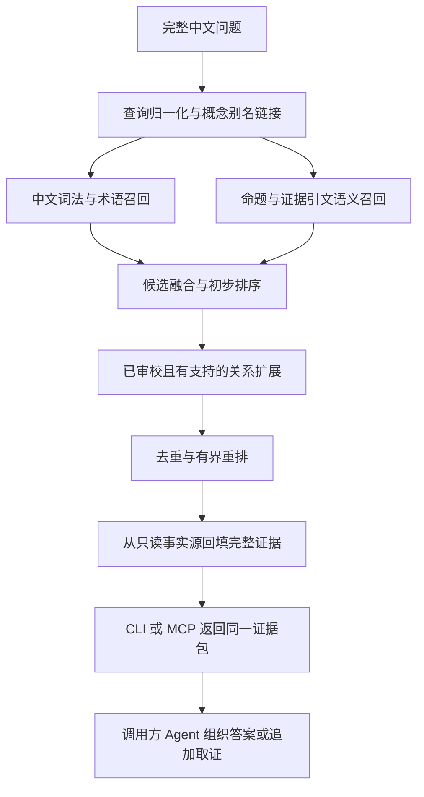

# 面向 Agent 的 RAG＋知识图谱检索：研究结论与迁移方案

研究日期：2026-10-22。状态：基础迁移方案已获用户确认；尚未实现或验收新的检索能力。用户原话为“本轮问题全部按你推荐，全部没问题”。随后新增的歧义及候选知识处理要求另作专项研究，并补入检索契约。

已确定的产品约束：Windows 本地独立目录及 ZIP；回答由调用方 Agent 生成；桌面应用退出交付主线；接入方式由研究结果拟定。本轮只新增研究文档，没有修改检索代码、知识库、开发题或运行新方案评测。

## 结论与证据强度

推荐首版采用 **中文词法/术语与向量召回 → 候选融合 → 由已审校图谱补充证据 → 有界重排与上下文组织 → 向 Agent 返回可追溯证据包**。方法上以 KG²RAG 的种子—扩展—组织流程为主要参照；工程上参考成熟产品的混合检索和固定图扩展。该推荐是对当前语料、审校结构、便携交付和机器资源作出的适配判断，不能继承任何论文分数。[KG²RAG，NAACL 2025](https://aclanthology.org/2025.naacl-long.449/)、[Azure 混合检索](https://learn.microsoft.com/en-us/azure/search/hybrid-search-overview)、[Neo4j 检索器](https://neo4j.com/docs/neo4j-graphrag-python/current/user_guide_rag.html#hybrid-cypher-retrievers)

这里的“主流”以多个维护中的官方产品/SDK提供正式功能、以及正式研究提出并评测相应机制作为操作性证据。未取得部署市场份额数据，也没有证据支持某一个 GraphRAG 算法在所有任务统一最优。通用图谱增强 RAG 是方法类别，Microsoft GraphRAG 是其中一个具体框架。

### 已查到的主要路线

| 路线 | 一手证据及正式状态 | 机制与适用范围 | 迁移决定 |
| --- | --- | --- | --- |
| 混合检索与后阶段重排 | Azure、Elastic 官方能力 | 词法和向量共同召回，RRF 等方法融合；小候选集进一步判断相关性 | 作为检索底座；融合和重排是否默认启用由本语料评测确定 |
| 局部图扩展 | Neo4j `HybridCypherRetriever`；KG²RAG，NAACL 2025 长文 | 找种子，再取相连知识及原文，组织相关上下文 | 首版主线；在 SQLite 上实现对应模式，不意味着使用 Neo4j SDK |
| 实体/关系双层检索 | LightRAG，EMNLP 2025 Findings | 具体实体与高层关系/主题两个入口 | 借鉴概念、命题与关系多入口；保留原有审校语义 |
| 图传播、多跳关联 | HippoRAG，NeurIPS 2024；HippoRAG 2，ICML 2025 | Personalized PageRank 等传播将查询链接到更远知识与段落 | 作为后续消融实验，先测有预算的局部扩展 |
| 全局摘要与探索 | Microsoft GraphRAG 官方 Global / DRIFT；原始论文核到预印本 | 社区报告、分批汇总，或报告引导多轮探索 | 为全书主题综述保留独立实验路径，首版以精确取证为验收核心 |
| Agent＋专门图工具 | BYOKG-RAG，EMNLP 2025 主会 | 模型提出实体/路径等线索，工具链接和检索，再迭代 | 支持调用方 Agent 规划、项目提供确定性工具的产品分工 |

来源：[Azure](https://learn.microsoft.com/en-us/azure/search/hybrid-search-overview)、[Elastic Hybrid](https://www.elastic.co/docs/solutions/search/hybrid-search)、[Elastic Reranking](https://www.elastic.co/docs/solutions/search/ranking/semantic-reranking)、[Neo4j](https://neo4j.com/docs/neo4j-graphrag-python/current/user_guide_rag.html)、[KG²RAG](https://aclanthology.org/2025.naacl-long.449/)、[LightRAG](https://aclanthology.org/2025.findings-emnlp.568/)、[HippoRAG](https://proceedings.neurips.cc/paper_files/paper/2024/hash/6ddc001d07ca4f319af96a3024f6dbd1-Abstract-Conference.html)、[HippoRAG 2](https://proceedings.mlr.press/v267/gutierrez25a.html)、[GraphRAG Global](https://microsoft.github.io/graphrag/query/global_search/)、[GraphRAG DRIFT](https://microsoft.github.io/graphrag/query/drift_search/)、[GraphRAG 作者出版物页](https://www.microsoft.com/en-us/research/publication/from-local-to-global-a-graph-rag-approach-to-query-focused-summarization/)、[BYOKG-RAG](https://aclanthology.org/2025.emnlp-main.1417/)。最后一列均为本项目建议。

RRF 合并已有排名，重排器判断问题与候选内容相关性；二者不承担原文身份认证。更复杂机制是否有增益必须独立测量。LightRAG 主评测包含生成答案成对偏好，HippoRAG 2 则分别报告答案 F1 与段落 Recall，不能将这些分数混排成“检索准确率榜单”。正式 PDF 核对及评测边界见[学术证据](2026-10-22-academic-graph-rag.md)。

Microsoft 也支持 Bring Your Own Graph，可复用既有实体、关系及 text units，再运行所需派生步骤；不能说使用它必然要求重抽全书。其基础模型仍需额外映射本项目的命题条件、review 状态和原文身份，Global 还涉及社区报告生成。首版选择直接复用当前事实源，是本项目的实现取舍。[官方 BYOG](https://microsoft.github.io/graphrag/index/byog/)

## 当前可直接复用的资产

只读核查版本 `0.1.0-review-307029129712`，schema `1.1.0`：318 概念、3,369 reviewed 命题、4,584 reviewed 引文、692 reviewed 关系、9,650 原文段落。另有 2,611 pending、28 rejected 命题；已复核知识仍保留显式歧义。[manifest](../../../shared-knowledge/v0.1.0/manifest.json)、[当前交付说明](../../../deliveries/chan-knowledge-20261022-307029129712/README.md)

现有 `KnowledgeGraph` 是只读权威读取层，已能返回条件、身份、页码、字符和坐标；CLI 与 JavaScript API 可保留。现有搜索主要是整串/概念匹配，向量通道尚未实现。`neighbors` 从关系两端发现关联，不能作为有向逻辑推理接口。[查询核心](../../src/core.mjs)、[CLI](../../bin/chan-kg.mjs)

现有自然问题评测读数如下；本轮没有重跑：

| 冻结开发方案 | Recall@10 | Recall@20 |
| --- | ---: | ---: |
| 原文词法 | 43.35% | 51.23% |
| reviewed 结构化词法 | 72.00% | 81.89% |
| 原文＋结构化等权 RRF | 67.38% | 79.60% |
| 现有生产 search 直接输入整句 | 6.96% | 12.53% |

这些读数来自相同版本上的240道模型复核开发题，评价标注证据段落召回；不是独立人工测试，也没有评生成答案。等权 RRF 低于结构化词法，说明不能照搬默认融合参数。新方案应与较强的结构化词法基线比较，而非只要求超过当前低召回的整句 search。[最终结果](../../evaluation/stage-h-final-baselines-307029129712.results.json)

本机只读检查为 i5-1038NG7、4核8线程、约15.81 GiB 内存、Intel Iris Plus，Node 24.15.0。默认可用性以 CPU 为基线；尚未下载或测试任何新模型。[本地核查](2026-10-22-local-migration-evidence.md)

## 拟议的完整检索流程

以下为建议契约，尚未实现：

1. **默认 reviewed 知识池**：已复核命题及其所属的精确证据引文。evidence 没有独立 review_status，按所属命题过滤；同一父段落中未被引证的其他句子只作语境，不随之升级为已复核事实。关系须 reviewed，且保留经当前策略允许的支持命题。概念本身没有独立 review_status，其存在不等于所有关联说法已复核。
2. **显式 source 模式**：检索更广原文时保留 role、speaker、课程/回复身份和 `semantic_review=not_asserted`；读者、未知身份、附录和相邻语境单列。原文命中不自动成为 reviewed 知识。
3. **查询与索引归一化**：全半角、别名、数字格式仅作用于派生检索字段；固定 PDF、原文、字符映射与稳定 ID 保持不变。超过模型长度时产生带 parent ID/码点区间的派生窗口，结果回到完整命题和原文。
4. **多入口候选**：已审校命题正文、条件、例外及相关概念构成结构化索引；原文证据提供另一文本视角。词法与向量融合只决定相关性，不修改 review 状态、命题种类或来源身份。
5. **图扩展**：从命中概念/命题取有支持的关系，记录关系原方向、遍历方向、支持 claim 与 evidence。先做一跳基线，显式两跳受节点、边、证据和上下文预算限制；主题邻近不自动构成支持或传递推论。
6. **重排**：只处理有限候选，比较20/40等预算；具体模型、默认开关和候选数由 CPU 实测及独立质量结果决定。不能把重排高分当作真实性、充分性或条件成立的证明。
7. **完整返回单元**：稳定 ID、命题正文、完整条件/例外、explicit/inferred、歧义、review 状态、原文引文、来源身份、PDF页码、字符/坐标入口、支持路径、召回原因、版本和预算状态。预算不足时整单元延期并标明截断，不静默删掉条件或例外。
8. **回答由调用方生成**：服务不增加常驻回答模型；调用方可继续读取 concept / neighbors / evidence。检索侧不需要额外生成式模型 API；本地 embedding/rerank 仍有模型、内存和计算成本。

### 用户追加的歧义与候选知识处理要求

基础迁移方案确认后，用户要求研究并利用作者含蓄表述中的有效信息。专项全量盘点确认：473条带显式歧义的reviewed命题已经在默认知识池内；2611条pending均为自动来源候选，不能当作同等数量的理论矛盾或独立知识缺口。

迁移设计补充为：知识模式保留歧义命题及其原标记、条件和解释分支；已知问题组定向补取相关读法与另一侧证据；Agent在显式研究模式下读取候选和解释假说，保留原始身份并与已复核结果分开。原文陈述、已复核命题、研究解释三者保持可追溯联系；不靠自动打分、日期或来源重复裁定作者用意。

处理方案、8例取证及全量机器队列见[歧义与候选知识专项研究](2026-10-22-ambiguity-handling.md)。[策略JSON](2026-10-22-ambiguity-handling-policy.json)是未加载到运行时的设计合同；本轮没有批量改变状态，也没有完成3084条逐条语义复核。

## 存储、运行时与模型适配

建议继续使用当前 SQLite 作为唯一事实源。新增独立派生索引目录，按图谱版本、索引格式和配置 profile 区分。`claim_concept` 与 `relation_support` 等精确连接表在派生索引中建立；现有 canonical 库只有 JSON TEXT 的 concept_ids/claim_ids，并无这些连接表。读取构建以实际数据库模式、schema版本和已核契约为依据。[契约与模式核查](2026-10-22-local-migration-evidence.md#4-关系可遍历性有向性及索引不足)

派生索引至少绑定 graph/schema 版本、canonical DB/manifest 哈希、索引输入快照哈希、模型不可变 revision/文件哈希、tokenizer/切块/过滤/归一化版本、dtype/维度/池化、融合与重排配置。SQLite backup 的物理哈希可与原文件不同，必须分开记录。启动发现不匹配时返回明确的陈旧索引状态，不能静默混用。

CPU 小模型先作为工程基线候选，例如中文 `BAAI/bge-small-zh-v1.5`；它不是本研究认定的最新或最优模型。模型卡标注中文、MIT，并说明查询指令与文档编码用法；模型选择及指令策略需要在本语料上比较。[作者模型卡](https://huggingface.co/BAAI/bge-small-zh-v1.5)

运行时优先评估现有 Node＋本地 ONNX/Transformers.js 的单运行时路线。官方支持本地模型位置和禁用远程模型加载；原作者权重、ONNX导出、量化和池化的一致性仍需专门核验，不能把任意转换文件视为已验证兼容。[Transformers.js 自定义模型](https://huggingface.co/docs/transformers.js/custom_usage)

当前约万级段落集合可先将精确向量扫描作为简单基线，再由实测决定是否增加近似索引。向量数组体积不代表模型推理内存。重排按实际质量/延迟选默认配置，并输出是否启用、超时或降级状态；CPU冷启动、热查询p50/p95、峰值内存和包体均在实施实验后报告。

## Q5 拟定：同一核心，CLI＋本地 MCP

采用一个检索服务与一套请求/结果契约：

| 入口 | 用途 | 拟议能力 |
| --- | --- | --- |
| CLI / JSON | 可执行终端命令的 Agent、脚本与诊断 | 新 retrieve / status；兼容原八个查询命令；stdout为JSON，日志为stderr |
| MCP stdio | 支持 MCP 的本地 Agent 客户端 | retrieve、concept、neighbors、evidence、coverage/status 等只读工具，共享相同默认策略和证据包 |
| JavaScript API | 直接集成 | 同一服务调用，不复制检索算法 |

本地 stdio 通过进程标准输入输出交换请求，无需为首版另建远程服务。MCP是调用协议；它本身不决定检索质量。实施时固定SDK版本并与实际目标客户端做协议、发现、调用和断连验收。[MCP 官方架构](https://modelcontextprotocol.io/docs/learn/architecture)

日常目录应只包含 app、knowledge、indexes、models、runtime、licenses及启动入口；用包根相对定位。开发审校和历史评测留在维护工程/审计资料中。项目提供检索与证据，调用方 Agent 完成最终生成，两者共同构成应用中的 RAG 流程。

## 迁移阶段与验收

| 阶段 | 具体产物 | 退出条件 |
| --- | --- | --- |
| 0 固定契约与基线 | 同版本事实快照、ID投影、返回契约、开发/测试边界 | 默认复核策略、角色、条件、码点偏移和证据链无损；历史未跟踪文件受保护 |
| 1 正式词法检索 | 可接收完整问题的结构化词法/别名入口 | 与冻结结构化基线比较，旧命令兼容，身份与状态负例通过 |
| 2 向量与混合召回 | 本地模型、派生向量与索引清单 | 同语料同预算比较纯词法/纯向量/融合；模型与索引可完全离线加载 |
| 3 图谱与重排 | 有方向和类型记录的支持路径、候选预算、重排profile | 与无图、无重排版本作消融；新增路径均可追到有效证据；增益与代价分别报告 |
| 4 Agent接入 | 共用核心的CLI、MCP和调用指南 | 相同请求的版本、过滤策略和证据一致；真实Agent追加取证和引用样例可核查 |
| 5 便携ZIP | 运行时/模型/图谱/索引/许可证/哈希/回执 | 实际解压件在移动及中文空格路径、断网且无全局运行时环境完成验收；原知识库/PDF哈希未变 |

模型与算法调参使用既有240题开发回归集。独立验收集合在调参前冻结，明确标注与复核者；未人工核过的题不标“人工金标准”。题型覆盖术语、改写、条件/例外、跨课证据组、关系方向、原文身份和证据不足。需同时报告Recall@K、排序质量、完整证据组覆盖、错误来源和默认未核泄漏、时延及资源。图扩展应证明带来了可用证据，而不是仅证明返回了更多边。

生成回答单独固定调用方Agent/模型/提示词，对引用、条件保留、明说与推论区分、证据不足时的表述做检查；不以检索命中代替生成正确性。所有对外效果结论必须写明集合与指标口径。

全局社区报告、PPR传播和内部LLM路由作为后续实验项，分别需要全局问题集、多跳关联题和成本/路由消融。它们不被本首版的局部取证验收隐式宣称已交付。

## 审计附录

- [业界官方实现证据](2026-10-22-industry-graph-rag.md)
- [正式论文与评测边界](2026-10-22-academic-graph-rag.md)
- [本地字段、模式、评测和硬件核查](2026-10-22-local-migration-evidence.md)

用户已确认本报告所述基础迁移主线及接口取舍，原 grilling 决策轮次已结束，无需重复确认 CLI/MCP、调用方生成或 Windows 独立目录 ZIP。后续实施先纳入专项歧义研究的处理契约，并继续区分研究成果、代码实现及实际交付验收。
